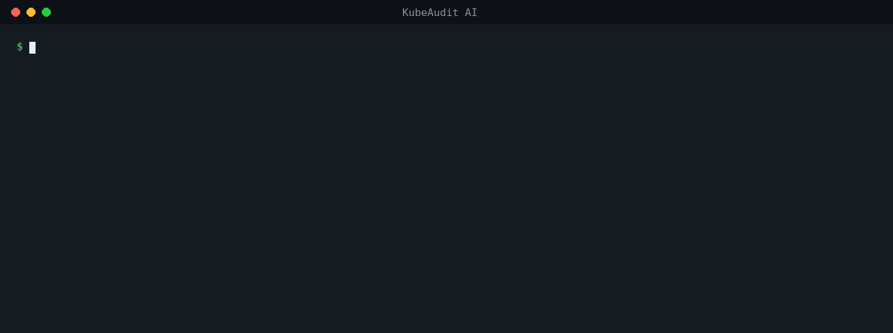

<div align="center">

# 🛡️ KubeAudit AI

**Catch Kubernetes security misconfigurations in pull requests, before they reach a cluster.**

[](https://github.com/kubeaudit-ai/KubeAudit-Ai/actions/workflows/ci.yml)
[](https://github.com/kubeaudit-ai/KubeAudit-Ai/releases)
[](LICENSE)
[](https://kubeaudit-ai.github.io/)

[**Try it in your browser**](https://kubeaudit-ai.github.io/) · [GitHub Action](#-quick-start-github-action) · [CLI](#cli) · [Admission webhook](#in-cluster-admission-webhook) · [Rules](#rules)

</div>

<p align="center"></p>

KubeAudit AI scans Kubernetes YAML and Helm charts, points to the **exact line** of each problem, and **shows the fix**, right in the pull request. One rule engine, three places to run it: a GitHub Action, a CLI, and an in-cluster admission webhook.

- 📍 **Line-accurate findings** in a single PR comment and in GitHub code scanning (SARIF)
- 🛠️ **A fix for every finding**, as a ready-to-paste YAML snippet
- ⛵ **Helm-aware:** charts are rendered with `helm template` first, so templated values get checked too
- 🔒 **Nothing leaves your runner.** Rules are deterministic, need only Python and PyYAML, and work offline. Same input, same findings, every time.
- ⚡ **Fast on big repos:** `only-changed: true` scans just the files a PR touches

## 🚀 Quick start: GitHub Action

Add `.github/workflows/kubeaudit.yml`:

```yaml
name: KubeAudit
on: [pull_request]

permissions:
  contents: read
  pull-requests: write     # PR comment
  security-events: write   # code scanning upload

jobs:
  scan:
    runs-on: ubuntu-latest
    steps:
      - uses: actions/checkout@v5
      - uses: kubeaudit-ai/KubeAudit-Ai@v1.2.1
        with:
          fail-on: high        # critical | high | medium | low | none
          only-changed: true   # scan just the files this PR touches
```

That's it. Open a PR that touches a manifest and you get one comment like this (real output on the [sample manifest](manifests/sample-deployment.yaml)):

> ## 🛡️ KubeAudit AI
> ⚠️ 10 findings in 1 resource: 🔴 1 critical · 🟠 2 high · 🟡 3 medium · ⚪ 4 low
>
> - 🔴 **KA001 · Container runs in privileged mode** (line 19)
>   container `demo-web` in Deployment/demo-api runs privileged.
>   **Fix:** `securityContext: { privileged: false }`
> - 🟠 **KA002 · Container allows privilege escalation** (line 18)
>   **Fix:** `securityContext: { allowPrivilegeEscalation: false }`
> - …

The comment updates in place on every push instead of piling up, and findings also show inline in the PR's **Files changed** tab via code scanning.

<details>
<summary><b>All Action inputs and outputs</b></summary>

| Input | Default | Description |
|---|---|---|
| `path` | `.` | Files or directories to scan, space-separated |
| `only-changed` | `false` | On PRs, scan only changed files (and the Helm charts they belong to) |
| `fail-on` | `high` | Fail the check at or above this severity |
| `min-severity` | `low` | Hide findings below this severity |
| `ignore` | | Comma-separated rule IDs to skip |
| `config` | | Path to a `.kubeaudit.yaml` (defaults to the repo root's) |
| `comment` | `true` | Post or update one summary comment on the PR |
| `comment-key` | workflow/job | Keeps separate KubeAudit jobs from overwriting each other's PR comment |
| `sarif` | `true` | Upload to code scanning (private repos need GitHub Advanced Security) |
| `setup-helm` | `true` | Install Helm to render charts |

Outputs: `findings`, `critical`, `high`, `sarif-file`, `report-file`.

</details>

## 🌐 Web app: no install

**[kubeaudit-ai.github.io](https://kubeaudit-ai.github.io/)**

Paste or drop Kubernetes YAML and get a security score, each problem marked on its line with the fix, and a **one-click hardened file**. It runs entirely in your browser (nothing is uploaded), works offline, and installs on phone or desktop ("Install app" / "Add to Home Screen").

The web app uses a JavaScript port of the same rule engine. CI checks that both engines report identical findings, and that the auto-fixer removes every fixable issue without changing anything else in the file.

## CLI

```bash
pip install "git+https://github.com/kubeaudit-ai/KubeAudit-Ai"

kubeaudit scan .                       # human-readable, exit 1 on high+ findings
kubeaudit scan k8s/ --format sarif -o results.sarif
kubeaudit scan . --fail-on critical --ignore KA014,KA015
kubeaudit rules                        # list all rules
```

Drop it into GitLab CI, Jenkins, a pre-commit hook, or anywhere else Python runs.

## Rules

15 rules covering the misconfigurations that most often turn into real incidents:

| ID | Severity | Name | Checks for |
|---|---|---|---|
| KA001 | 🔴 Critical | PrivilegedContainer | Container runs in privileged mode |
| KA002 | 🟠 High | AllowPrivilegeEscalation | Container allows privilege escalation |
| KA003 | 🟠 High | RunAsNonRoot | Container may run as root |
| KA004 | 🟠 High | HostNamespaces | Pod shares host namespaces |
| KA005 | 🟠 High | HostPathVolume | Pod mounts a hostPath volume |
| KA006 | 🟠 High | DangerousCapabilities | Container adds dangerous Linux capabilities |
| KA007 | 🟠 High | HardcodedSecretEnv | Secret value hard-coded in an environment variable, including passwords inside URLs like `DATABASE_URL` |
| KA008 | 🟠 High | RBACWildcard | RBAC rule grants wildcard access |
| KA009 | 🟡 Medium | ImageNotPinned | Image uses latest or no tag |
| KA010 | 🟡 Medium | ReadOnlyRootFilesystem | Root filesystem is writable |
| KA011 | 🟡 Medium | MissingMemoryLimit | Container has no memory limit |
| KA012 | ⚪ Low | DropAllCapabilities | Container does not drop all capabilities |
| KA013 | ⚪ Low | MissingResourceRequests | Container has no CPU or memory requests |
| KA014 | ⚪ Low | MissingProbes | Long-running container has no readiness or liveness probe |
| KA015 | ⚪ Low | AutomountServiceAccountToken | Service account token is mounted automatically |

Workloads checked: Pod, Deployment, StatefulSet, DaemonSet, ReplicaSet, ReplicationController, Job, CronJob, including init and ephemeral containers. RBAC checks cover Role and ClusterRole.

Missing a check you care about? [Open an issue](https://github.com/kubeaudit-ai/KubeAudit-Ai/issues/new) with an example manifest.

## How it compares

There are excellent tools in this space, and you may already run one. KubeAudit AI is deliberately narrow: it focuses on the pull-request experience, where a reviewer sees the problem, the line, and the fix without leaving GitHub.

| | KubeAudit AI | [Trivy](https://trivy.dev) | [Polaris](https://github.com/FairwindsOps/polaris) | [kube-score](https://github.com/zegl/kube-score) |
|---|:---:|:---:|:---:|:---:|
| Kubernetes YAML checks | ✅ | ✅ | ✅ | ✅ |
| Renders Helm charts before scanning | ✅ | ✅ | ✅ | via `helm template \| kube-score score -` |
| SARIF for GitHub code scanning | ✅ | ✅ | — | ✅ |
| PR summary comment with fix snippets, built in | ✅ | — | — | — |
| Auto-fix / hardened output | ✅ web app + mutating webhook | — | ✅ `polaris fix` (raw YAML) + mutating webhook | — |
| Validating admission webhook | ✅ | — | ✅ | — |
| In-browser scanner, nothing uploaded | ✅ | — | — | — |
| Scans beyond Kubernetes (images, Terraform, Dockerfiles…) | — | ✅ | — | — |
| Breadth of built-in checks | 15 rules | Large | Large | Large |

<sub>— means not offered or not documented as of October 2026. Corrections welcome via issue or PR.</sub>

**Pick Trivy** if you want one scanner for images, IaC and Kubernetes. **Pick Polaris** for a cluster-wide dashboard and a broad policy set. **Pick kube-score** for a lightweight, mature CLI. **Pick KubeAudit AI** if your priority is fixing misconfigurations in the PR, with one comment that tells the author exactly what to change. They also combine well, for example KubeAudit's PR comment for manifests alongside Trivy for image vulnerabilities.

## Configuration

Put `.kubeaudit.yaml` in the repo root:

```yaml
fail_on: high
min_severity: low
ignore: [KA015]                 # rule IDs or names
exclude: ["examples/*", "test/fixtures/*"]
helm:
  values:
    charts/my-app: [values-prod.yaml]   # values files per chart
```

Skip rules on one resource with an annotation:

```yaml
metadata:
  annotations:
    kubeaudit.ai/ignore: "KA004,KA005"   # or "all"
```

## In-cluster admission webhook

The same rules can guard the cluster itself, as a validating and mutating admission webhook for pods.

- **Mutating:** on pod creation it adds a non-root security context, turns off privilege escalation and privileged mode, and adds default CPU and memory limits and requests. Images are never rewritten; unpinned images are reported instead.
- **Validating:** denies pods that still have critical or high findings.
- **Zero-dependency TLS:** the Helm chart generates its own CA and serving certificate (`tls.autoGenerate: true`) and injects the CA into both webhook configurations. cert-manager is not required.
- **Safe defaults:** `kube-system`, `kube-public`, `kube-node-lease` and the `kubeaudit` namespace are excluded. The webhook itself runs non-root with a read-only root filesystem.
- **Observable:** FastAPI service with `/audit`, `/fix`, `/validate`, `/mutate`, `/health` and Prometheus `/metrics`.

```bash
helm repo add kubeaudit https://kubeaudit-ai.github.io/KubeAudit-Ai/
helm repo update
helm upgrade --install kubeaudit kubeaudit/kubeaudit-ai -n kubeaudit --create-namespace
kubectl rollout status deployment/kubeaudit-kubeaudit-ai -n kubeaudit --timeout=180s
```

<details>
<summary><b>Local development with kind, and watching the mutation happen</b></summary>

These are the same steps CI runs on every push.

```bash
kind create cluster --name kubeaudit
docker build --provenance=false -t kubeaudit-ai:latest .
kind load docker-image kubeaudit-ai:latest --name kubeaudit

helm upgrade --install kubeaudit charts/kubeaudit-ai/ \
  --namespace kubeaudit --create-namespace \
  --set image.repository=kubeaudit-ai \
  --set image.tag=latest \
  --set image.pullPolicy=Never

kubectl rollout status deployment/kubeaudit-kubeaudit-ai -n kubeaudit --timeout=180s
```

Apply the deliberately insecure sample. The webhook patches the **pods** it creates, so inspect a pod rather than the Deployment:

```bash
kubectl apply -f manifests/sample-deployment.yaml
POD=$(kubectl get pod -n default -l app=demo-api -o jsonpath='{.items[0].metadata.name}')

kubectl get pod "$POD" -n default -o jsonpath='{.spec.securityContext.runAsNonRoot}{"\n"}'
kubectl get pod "$POD" -n default -o jsonpath='{.spec.containers[0].securityContext}{"\n"}'
kubectl get pod "$POD" -n default -o jsonpath='{.spec.containers[0].resources}{"\n"}'
```

If the pod is not created, `kubectl get events -n default` shows the validating webhook's reason for denying it.

</details>

## Free and Pro

The scanner, GitHub Action, CLI, webhook and web app are **free**. Scanning always happens in your browser or on your own runner.

Sign in with GitHub, Google, Microsoft or email to get an API key. **Pro ($9/month or $90/year, 14-day money-back guarantee)** adds saved scan history, shareable report links, custom rule settings and 2,500 API scans a month. An account stores only what you choose to save.

[Terms](https://kubeaudit-ai.github.io/terms.html) · [Privacy](https://kubeaudit-ai.github.io/privacy.html) · [Refunds & cancellation](https://kubeaudit-ai.github.io/refund.html) · Server setup: [docs/ACCOUNTS_SETUP.md](docs/ACCOUNTS_SETUP.md)

## FAQ

**Where's the AI?**
Detection is deliberately *not* an LLM. Security checks need to be reproducible and auditable: the same manifest gets the same findings on every run, on every machine, offline. The "AI" is the problem KubeAudit is built for: Kubernetes YAML is increasingly written by AI coding assistants, and that YAML often runs privileged, as root, on `:latest`. KubeAudit is the deterministic guardrail that catches it in the PR, whoever (or whatever) wrote it.

**Does my code leave my machine?**
No. The Action and CLI run on your runner, and the web app scans in your browser. Only Pro features you opt into (history, share links) store anything.

## Contributing

Bug reports, false positives, and rule ideas are all welcome. A minimal manifest that reproduces the problem is the most useful thing you can include. The JavaScript and Python engines are kept in lockstep by CI, so a new rule needs both plus a test fixture.

---

<div align="center">

**If KubeAudit AI caught something in your cluster, a ⭐ helps other people find it.**

</div>

<sub>Licensed under the [Apache License 2.0](LICENSE).</sub>
